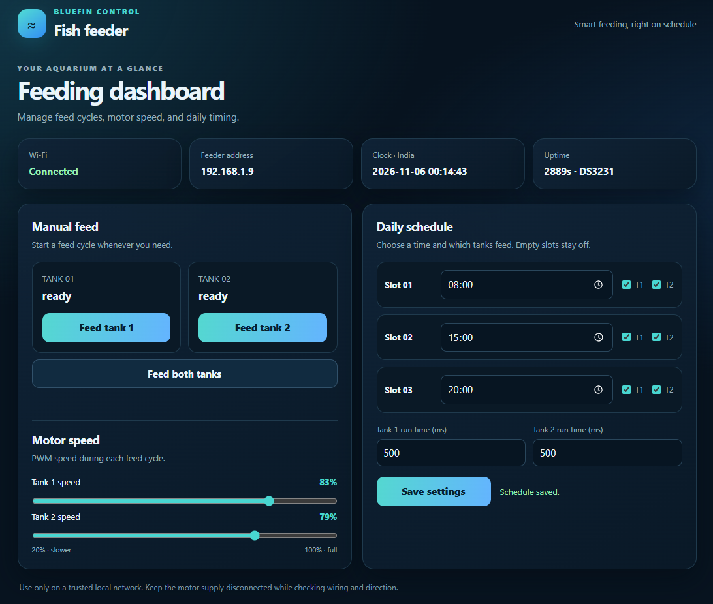

# Bluefin Fish Feeder

Bluefin is a Wi-Fi-enabled automatic fish feeder built around a NodeMCU v3
(ESP8266). Its local web dashboard controls two feeder motors and lets you
configure up to three daily feeding times. A DS3231 real-time clock keeps
schedules running when Wi-Fi is unavailable.

## Dashboard

Open the feeder's IP address in a browser on the same local network to use the
dashboard.



## Features

- Manually start a feed cycle for either tank or both tanks.
- Configure three daily schedule slots and choose which tank or tanks each
  slot feeds.
- Set each tank's motor speed from 20% to 100% and run duration from 100 to
  10,000 ms.
- Save settings and daily feeding completion state in EEPROM.
- View Wi-Fi status, the feeder's IP address, clock time, motor state, and
  uptime on the dashboard.
- Use the DS3231 as the schedule clock while offline; when Wi-Fi is available,
  NTP can set or correct the clock to India time (IST, UTC+05:30).

Schedules are disabled by default. Select tank assignments and save the
settings before relying on scheduled feeding.

## Hardware

- NodeMCU v3 development board (ESP8266)
- DRV8833 dual motor driver
- DS3231 real-time clock module with backup battery
- Two DC motors and suitable feeder mechanisms
- A separate motor power supply appropriate for the motors and driver

### Wiring

| NodeMCU v3 | Connect to |
| --- | --- |
| D6 (GPIO12) | DRV8833 IN1 |
| D5 (GPIO14) | DRV8833 IN2 |
| D0 (GPIO16) | DRV8833 IN3 |
| D7 (GPIO13) | DRV8833 IN4 |
| D2 (GPIO4) | DS3231 SDA |
| D1 (GPIO5) | DS3231 SCL |
| 3V3 | DS3231 VCC |
| GND | DS3231 GND and DRV8833 GND |

Connect each motor to one of the DRV8833 output pairs and power the motors
from a separate supply rated for the motors and driver. Connect the motor
supply ground to the DRV8833 and NodeMCU ground. Do not power motors from the
NodeMCU.

Use 3.3 V for the DS3231 module so its I2C pull-ups are safe for the ESP8266.
The DS3231 backup battery keeps time while the NodeMCU is unpowered.

**Safety:** Keep motor power disconnected during initial firmware and clock
testing. Before connecting it, verify the motor wiring and direction, secure
the feeder mechanism, and test the run duration and speed with the feeder
under supervision. Tune speed carefully; a motor may stall at low PWM
depending on its load and supply.

## Setup

### 1. Configure Wi-Fi

Wi-Fi is enabled in the firmware. Use a 2.4 GHz network.

1. Copy `include/wifi_config.h.example` to `include/wifi_config.h` if the
   local file does not exist.
2. Set `WIFI_SSID` and `WIFI_PASSWORD` in `include/wifi_config.h`.
3. Keep your real credentials out of commits. `include/wifi_config.h` is
   ignored by Git; commit only the example file.

The NodeMCU uses DHCP. After connecting, the assigned IP address is printed
to Serial and shown on the dashboard. A DHCP reservation on your router is
optional if you want the address to remain predictable.

### 2. Build and upload

Install [PlatformIO](https://platformio.org/) and open this project. The
PlatformIO environment is `nodemcuv2`. Connect the NodeMCU over USB, then run
these commands from the project directory:

```text
pio run -e nodemcuv2
pio run -e nodemcuv2 --target upload
pio device monitor --baud 115200
```

The firmware uses the Arduino framework for ESP8266 and the Adafruit RTClib
library, which PlatformIO installs from `platformio.ini`.

### 3. Open the dashboard

Wait for the board to connect, find its IP address in the Serial Monitor, and
open `http://<IP>/` on a phone or computer connected to the same local
network.

## Using the feeder

1. With motor power still disconnected, confirm the dashboard loads and the
   clock is valid.
2. Connect motor power and test each tank with its manual feed button.
3. Set a cautious motor speed and run duration for each tank, then save.
4. Configure each schedule time and select the tank or tanks it should feed.
   Save the settings to enable the selected assignments.
5. Observe several feed cycles and adjust the settings as needed before
   leaving the feeder unattended.

Each schedule slot runs at most once per day for each selected tank. Run
duration, motor speed, schedule settings, and daily completion state are
stored in EEPROM. The firmware limits run duration to 100–10,000 ms and motor
speed to 20–100%.

## Clock and connectivity

The DS3231 is the preferred schedule clock when it has valid time, so feeding
can continue without Wi-Fi. If the RTC is missing or has lost its time, the
firmware waits for valid NTP time. Internet access is needed for NTP to set or
correct the RTC; once the DS3231 has valid time, scheduled feeding can
continue offline.

The firmware sets the time zone to India Standard Time. The Serial Monitor at
115200 baud reports startup/reset information, Wi-Fi status, DHCP address,
signal strength, uptime, disconnect count, local time, and clock source.

## Troubleshooting

- **Wi-Fi does not connect:** Check the SSID and password in
  `include/wifi_config.h`, and make sure the network is 2.4 GHz.
- **Dashboard does not load:** Confirm the phone/computer is on the same local
  network and use the current IP printed in Serial output.
- **Clock is waiting for time:** Check the DS3231 wiring and backup battery.
  If the RTC has no valid time, connect to Wi-Fi with internet access so NTP
  can set it.
- **Motor does not move or stalls:** Disconnect power before checking wiring.
  Confirm the driver and separate motor supply are suitable, grounds are
  common, and the selected speed is sufficient for the load.
- **Wi-Fi drops:** The firmware attempts to reconnect, but reliable
  long-term operation also depends on the router, interference, power, and
  hardware.

## Network access

The web dashboard has no authentication. Use it only on a trusted local
network: anyone who can reach the feeder can start a motor or change its
settings. Do not expose it directly to the public internet.
